#  Syno Toolbox

<!---  --->

### Description

Synology package containing many 007revad scripts that are too small to have their own package, as well as new ones that were never released as a script.

Available for DSM 7 and DSM 6. Supports x86_64, aarch64, armv7l and i686.

**With Syno Toolbox you can:**
- See information about your Synology NAS all in one place:
  - DSM version and latest update available.
  - Hardware information.
  - UPS status (including connected UPS clients.
  - LAN ports connected speeds.
  - LAN ports MAC addresses.
  - LAN ports WOL status.
  - DSM system partition information: Size, Used and Available.
  - DSM temp logs size.
  - Latest btrfs scrub results.
  - Last memory test results.
  - Date your Synology was manufactured.
  - DSM telnet recovery password of the day.

**The Tools tab includes:**
- Send a Wake-on-LAN packet to wake a sleeping devices on your local network.
- Check Access from the Internet to see if it is susceptible to ransomware.
- Check if your Synology's currently loaded nginx config is exploitable via NGINX2Root.
- Check QuickConnect to see if QuickConnect is enabled and if DSM access via QuickConnect is enabled.
- Failed Logins (DSM and SSH) warns you if there are any failed DSM or SSH login attempts in the last 24 hours.
- Check Synology Security Advisory lists for any new or updated advisories with information about those advisories.
- Change Size Units displayed in DSM to Binary.
- Cleanup Coredumps that crashed packages and services leave behind.
- Enable Seagate Low Current Spinup on large Seagate Exos and IronWolf Pro HDDs.
- Enable using Secure Erase in DSM 7's Storage Manager for drives in an eSATA, Infiniband or USB C expansion unit.
- Uninstall Active Insight automatically after a DSM update.
- Backup DSM's System Configuration weekly and optionally export it to other devices.
- Backup the Synoboot USB DOM Image and optionally export it to other devices.
- Backup Value/Junior model's MTD flash Image and optionally export it to other devices.
- Enable Sequential I/O for SSD Cache to restore the fast SSD cache speed from DSM 6.
- Switch between SHR and RAID Group or Enable RAID F1.
- Restore RS3621xs+/RS3621RPxs Quiet and Cool fan modes back to pre DSM 7.3.2 speeds.
- Enable or disable root SSH login and change the root password.
- Disable Reset Button if a broken reset button is causing random resets and loss of data.

**The Packages tab shows:**
- Synology, 007revad and SynoCommunity packages that have updates available.
- Packages that are risk of known exploits and which version to update to.
- Broken packages and why they are broken.
- Recently installed packages.
- Recently upgraded packages.
- Which packages depend on other packages.

**The Snapshots tab shows:**
- Which shared folders do or don't have snapshots, the number of existing snapshots etc.
- Which shared folders do or don't have immutable snapshots enabled.

**The Snapshots tab shows:**
- A CPU usage graph for the last 18 hours.

 

### How to install the package

There are 2 ways to install the package:

**Directly from Package Center**

1. Add [007revad Synology Package Source](https://github.com/007revad/Synology_package_source) to package Center.
2. Click on the Community section in Package Center and install the package.

<kbd>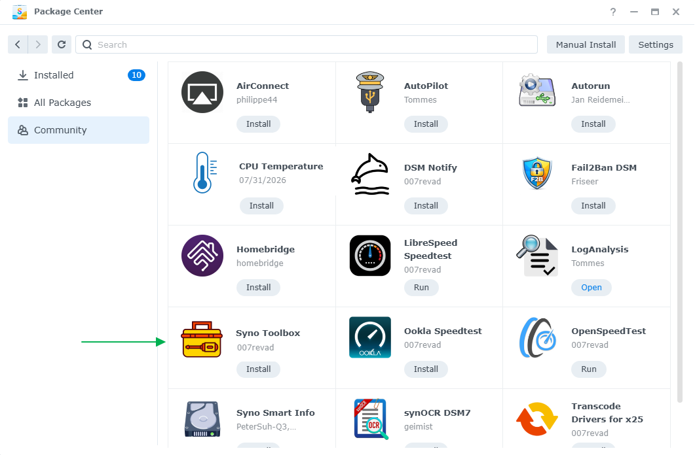</kbd>

**Or download the package and install it manually**
1. Download the latest version .spk file from https://github.com/007revad/Syno_Toolbox/releases and save it to your Synology.
2. In Package Center click on Manual Install.
3. Browse to where you downloaded the .spk file.
4. Select the .spk file and click Next.

 

### Screenshots

<!--- 
Description of image 1 goes here
 --->

<kbd>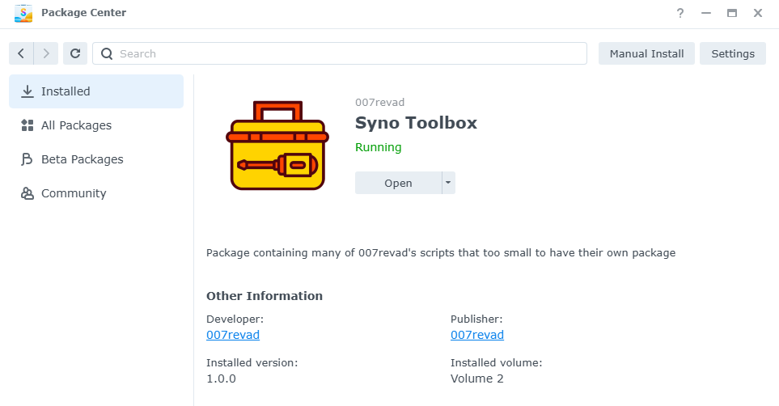</kbd>

<!---   --->

<!--- 
DS925+ Info (UPS client)
 --->
<!--- 
<kbd>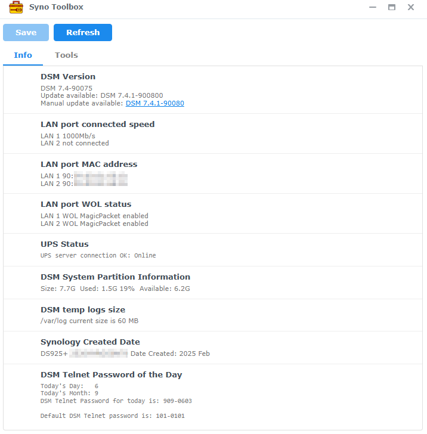</kbd>
 --->

 

Info

<kbd>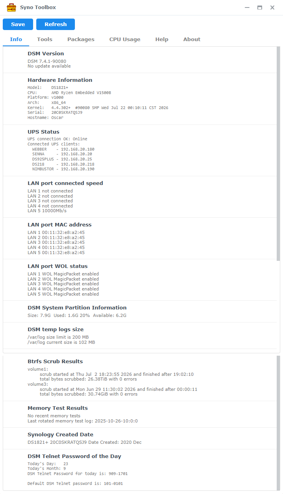</kbd>

 

Tools

<kbd>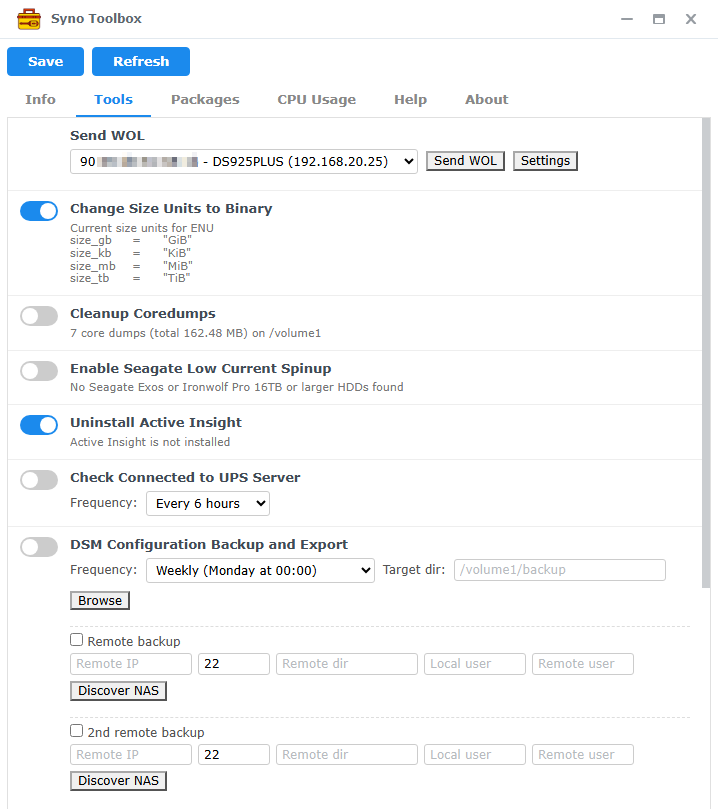</kbd>

 

More Tools

<kbd>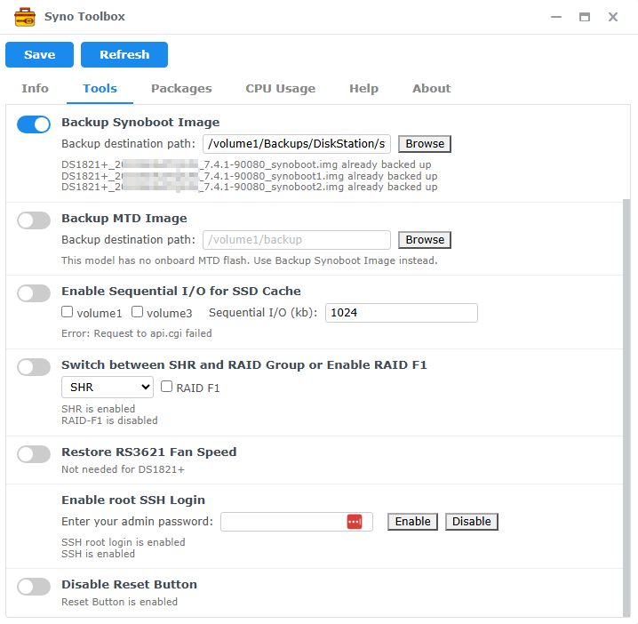</kbd>

 

Send WOL device selection

<kbd>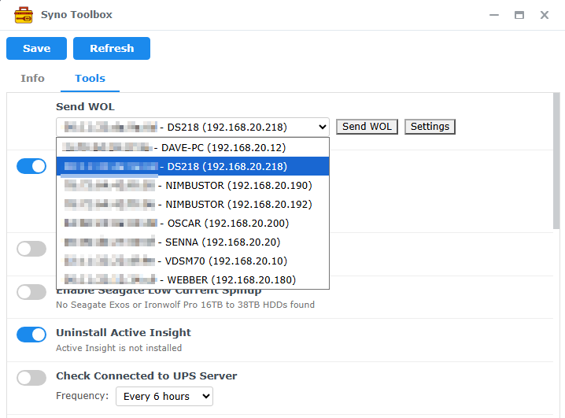</kbd>

 

Send WOL Settings

<kbd>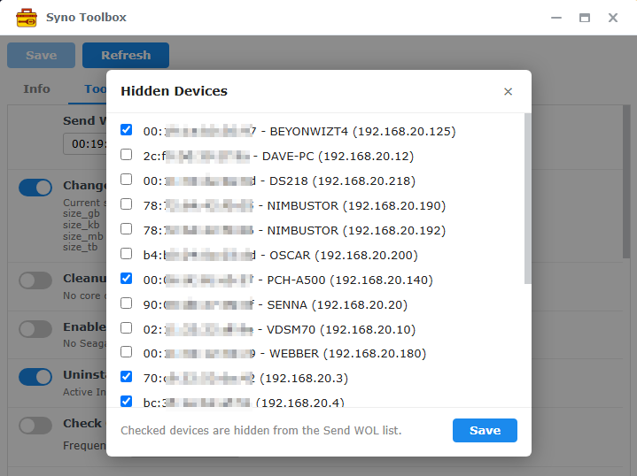</kbd>

 

Check Access from Internet

<kbd>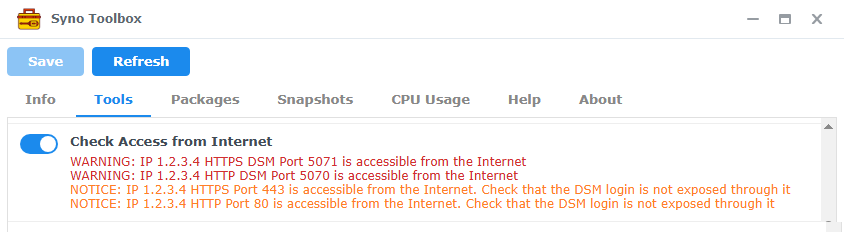</kbd>

 

Check QuickConnect and Failed Logins

<kbd>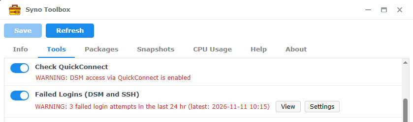</kbd>

 

Check Synology Security Advisory

<kbd>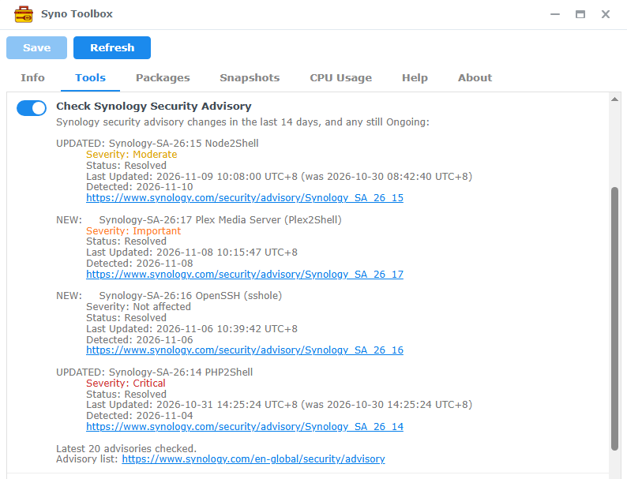</kbd>

 

Packages at Risk

<kbd>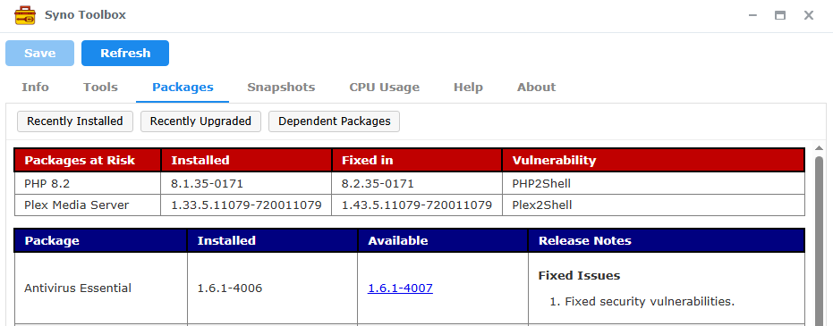</kbd>

 

Packages

<kbd>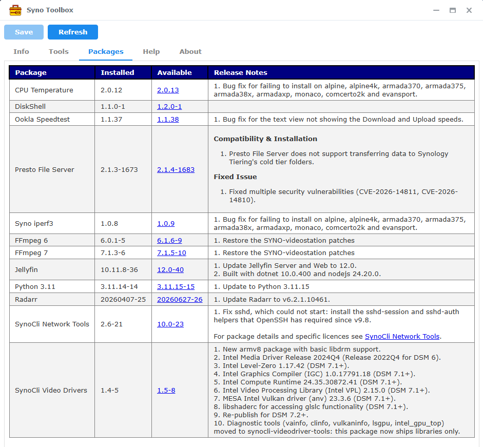</kbd>

 

CPU Usage

<kbd>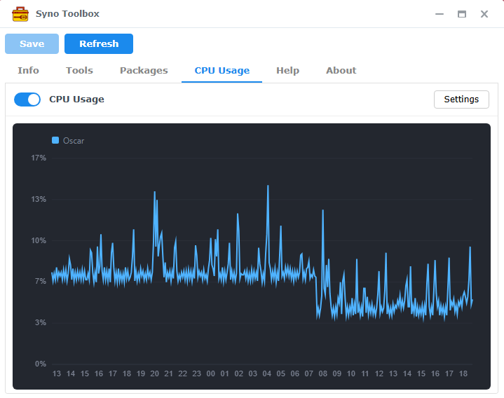</kbd>

 

Help

<kbd>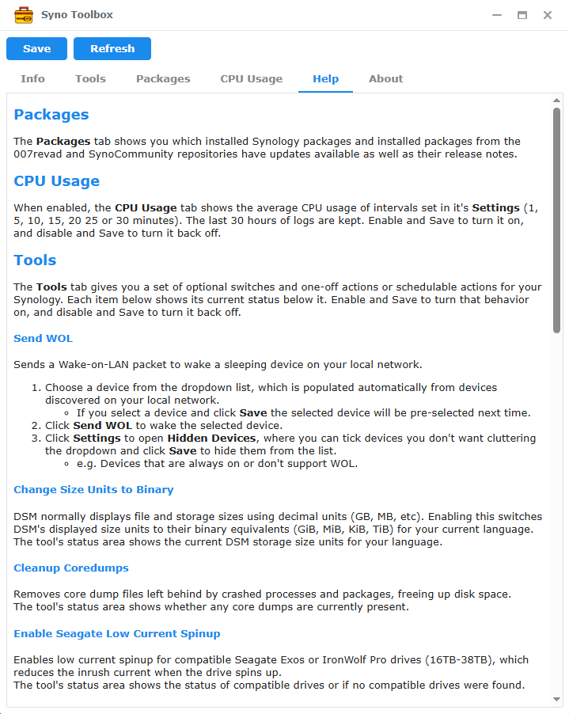</kbd>

